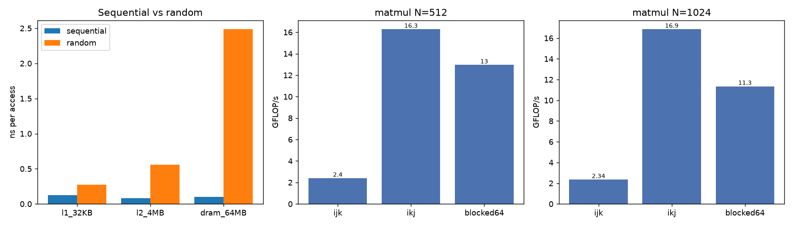
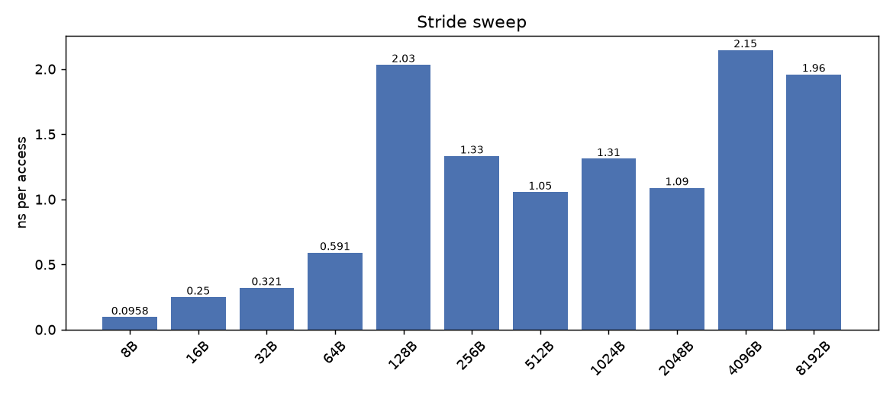
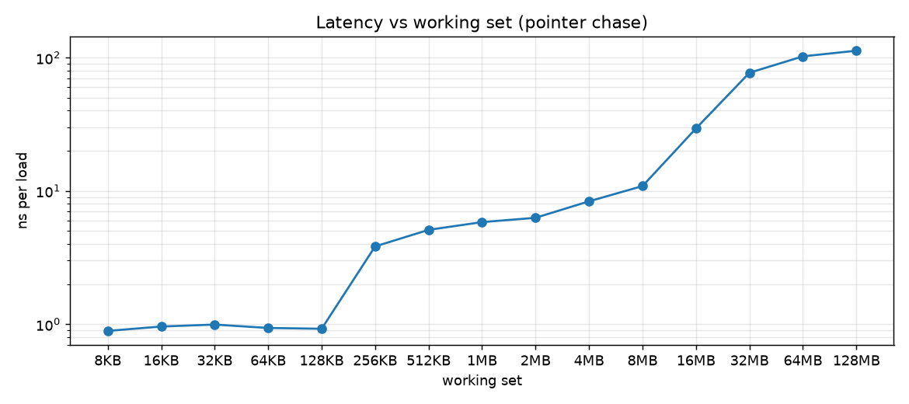
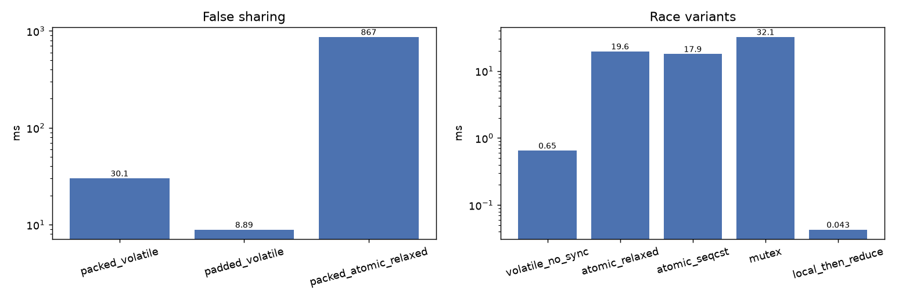

# Лабораторна робота №3 — Кеш, шаблони доступу до памʼяті та перегони

**Тема:** використання кешу та обмін з памʼяттю, оптимізація роботи з памʼяттю
(`volatile`, `atomic`), перегони й першість (race condition).

**Задача:** продемонструвати переваги та недоліки кешу на різних шаблонах
доступу до памʼяті: послідовний/випадковий доступ, stride, множення матриць,
хибне спільне використання (false sharing) та перегони при конкурентному
інкременті спільної комірки.

---

## 1. Середовище вимірювань

| Параметр | Значення |
|---|---|
| CPU | Apple M4 Pro (arm64), 14 логічних ядер |
| Розмір кеш-лінії | **128 байт** (`hw.cachelinesize`) |
| L1d (на ядро) | 64 КБ (`hw.l1dcachesize`) |
| L2 | 4 МБ (`hw.l2cachesize`) |
| ОС | macOS 27.2, AppleClang, `-O3 -Wall -Wextra`, C11 |
| Таймер | `clock_gettime(CLOCK_MONOTONIC)` |

Усі виміри зроблено нативно на Apple Silicon (не в Docker). На x86 з 64-байтною
лінією абсолютні числа будуть іншими (особливо для `stride` та false sharing),
але якісні співвідношення зберігаються.

---

## 2. Методика

Один бінарник `cache_benchmark` з шістьма незалежними бенчмарками; кожен
друкує CSV-рядки `benchmark,parameter,value,unit` у stdout, а версію
платформи — у stderr. Скрипт `lab3/scripts/run_benchmarks.py` збирає все у
`results/lab3_results.csv`.

Прийоми, що забезпечують коректність вимірів:

- результати всіх обчислень «зливаються» у `volatile`-змінну, щоб компілятор
  не викинув цикли (`-O3` інакше прибирає непотрібні обчислення);
- масиви вирівняні по 64/128 байт, розміри — ступені двійки;
- індекси випадкового доступу генеруються заздалегідь (час генерації не
  входить у вимір);
- прогрів перед замірами, серія повторів (для `mem` — 4 повних проходи);
- наведено два прогони, щоб показати розкид (особливо для перегонів).

Таблиці нижче — один репрезентативний прогін. Код також зібрано й запущено в
Debian bookworm (Linux у Docker, arm64) — без попереджень і без змін у коді.

---

## 3. Результати та аналіз

### 3.1 Послідовний проти випадкового доступу (`mem`)

Масив з `uint64_t`, 4 млн випадкових індексів; для кожного розміру робочої
множини порівнюється сума поспіль і сума за випадковими індексами.

| Робоча множина | Послідовно, нс/доступ | Випадково, нс/доступ | Уповільнення |
|---|---:|---:|---:|
| 32 КБ (вміщується в L1) | 0.122 | 0.495 | ×4.1 |
| 4 МБ (вміщується в L2) | 0.096 | 0.681 | ×7.1 |
| 64 МБ (поза кешем, DRAM) | 0.131 | 2.827 | ×21.6 |

**Пояснення.** Послідовний доступ оптимізується двома механізмами:
апаратним попереднім вибором (prefetcher) і векторизацією — тому час на
елемент практично не залежить від розміру масиву. Випадковий доступ
позбавляє обидва: кожні 128 байт лінії, що підтягуються, використовуються
лише частково, а кожен промах — це звернення до наступного рівня памʼяті.

Зверніть увагу: 2.8 нс/доступ на 64 МБ — це **пропускна здатність**, а не
латентність. Сучасний CPU виконує кілька незалежних промахів одночасно
(memory-level parallelism), тому «середня» ціна промаху в такому циклі значно
менша за реальну латентність промаху — див. п. 3.3, де ланцюжок залежних
завантажень показує ~105 нс.



### 3.2 Вплив кроку (stride) — `stride`

Буфер 32 МБ, крок у байтах, 4 млн доступів.

| Крок | нс/доступ | Коментар |
|---|---:|---|
| 8 Б (1 елемент) | 0.113 | повністю послідовно, векторизується |
| 16 Б | 0.379 | 1 лінія на 8 елементів → 1/8 ефективності |
| 32 Б | 0.392 | |
| 64 Б | 0.708 | |
| **128 Б (рівно лінія)** | **2.118** | **кожен доступ — новий промах, повторного використання лінії немає** |
| 256 Б | 1.631 | постійний крок розпізнається prefetcher'ом |
| 512 Б | 1.246 | |
| 1 КБ | 1.290 | |
| 2 КБ | 1.250 | |
| 4 КБ (сторінка) | 2.784 | додаються промахи TLB |
| 8 КБ | 2.545 | |

**Пояснення.** Мінімум — при кроці, кратному розміру елемента: дані
використовуються повністю. «Сходинка» на 128 Б — це межа кеш-лінії: кожне
завантаження приносить 128 байт, з яких використовується 8, тобто 16×
надлишкового трафіку, і жодного повторного використання (робоча множина
більша за L2). Після 128 Б час знову падає: постійний крок стає
передбачуваним для апаратного stride-prefetcher'а, який частково ховає
латентність. На кроці 4 КБ додатково проявляються промахи TLB (кожен доступ —
нова сторінка). Це класична ілюстрація «час на доступ ≠ час на елемент».



### 3.3 Крива латентності робочої множини (`latency`)

Випадковий цикл покажчиків (pointer chasing): 2 млн **залежних** завантажень,
що виключає паралелізм на рівні памʼяті й вимірює чисту латентність.

| Робоча множина | нс/завантаження | Рівень |
|---|---:|---|
| 8 КБ | 1.02 | L1 |
| 16 КБ | 0.95 | L1 |
| 32 КБ | 0.93 | L1 |
| 64 КБ | 0.91 | L1 |
| 128 КБ | 0.98 | L1 (межа) |
| 256 КБ | 4.06 | L2 |
| 512 КБ | 5.09 | L2 |
| 1 МБ | 5.63 | L2 |
| 2 МБ | 6.07 | L2 |
| 4 МБ | 7.92 | L2 (межа) |
| 8 МБ | 11.30 | L3/останній рівень |
| 16 МБ | 34.80 | перехід до DRAM |
| 32 МБ | 76.08 | DRAM |
| 64 МБ | 105.25 | DRAM |
| 128 МБ | 118.04 | DRAM |

**Пояснення.** Крива східчаста: до ~128 КБ латентність ~1 нс (L1), до 4 МБ —
4–8 нс (L2), далі різкий перехід до ~100–118 нс (DRAM). Сходинки на графіку —
це і є рівні ієрархії кешів: саме тому алгоритм, що вкладається в кеш,
працює на порядок швидше. Різниця між L1 і DRAM — **~100×**.



### 3.4 Множення матриць: порядок циклів і блокування (`matmul`)

`double`, три реалізації: `ijk` (наївна), `ikj` (кеш-дружня, внутрішній цикл по
`j` — суміжні елементи `B` і `C`), `blocked64` (блокування 64×64).

| Розмір | Варіант | Час, мс | GFLOP/s | Прискорення |
|---|---|---:|---:|---:|
| N=512 | ijk | 114.2 | 2.35 | 1.0× |
| N=512 | **ikj** | **15.9** | **16.87** | **7.2×** |
| N=512 | blocked64 | 20.4 | 13.16 | 5.6× |
| N=1024 | ijk | 948.6 | 2.26 | 1.0× |
| N=1024 | **ikj** | **130.6** | **16.45** | **7.3×** |
| N=1024 | blocked64 | 182.6 | 11.76 | 5.2× |

**Пояснення.** У `ijk` внутрішній цикл іде по `k` з кроком у цілий рядок
`B` (8 КБ для N=1024) — кожне звернення до `B[k][j]` є промахом, а рядок
`B` перечитується для кожного `i` (сумарно гігабайти трафіку). У `ikj`
внутрішній цикл іде по `j`: `B` і `C` читаються/пишуться послідовно,
векторизуються, а рядок `C` залишається в кеші. Результат — стабільні ~7×.

`blocked64` тут **повільніший** за `ikj`: на M4 Pro великий L2 (4 МБ) і
агресивний prefetcher уже добре обслуговують `ikj`, а блокування додає
накладні витрати (додаткові цикли, гірша векторизація). Це важливий висновок:
кеш-оптимізація — не догма, її треба міряти на конкретному залізі.

### 3.5 Хибне спільне використання — false sharing (`false-sharing`)

4 потоки, кожен 20 млн інкрементів **свого** лічильника. Лічильники або
лежать в одній кеш-лінії (`packed`), або рознесені з вирівнюванням по 128 Б
(`padded`).

| Варіант | Час, мс | нс/інкремент | Відносно padded |
|---|---:|---:|---:|
| packed, `volatile` | 30.16 | 0.377 | ×3.7 повільніше |
| **padded, `volatile`** | **8.09** | **0.101** | 1.0× |
| packed, `_Atomic` relaxed | 856.97 | 10.71 | **×106 повільніше** |

**Пояснення.** Потоки не мають спільного *даного*, але мають спільну
*кеш-лінію*. Кожен запис інвалідує лінію в інших ядрах (протокол когерентності,
MESI), і лінія «стрибає» між ядрами — це і є false sharing. Рознесення
лічильників по окремих лініях дає 3.7×. Ще показовіше: `_Atomic` **не
лікує** false sharing — packed-атоміки працюють у 106× повільніше за padded
`volatile`, бо кожен атомарний RMW на спільній лінії серіалізується через
кеш-когерентність. Атомарність гарантує коректність, але не продуктивність;
для продуктивності потрібне рознесення даних (padding/`alignas`) або
приватизація лічильників.

### 3.6 Перегони та першість (`race`)

4 потоки × 500 000 інкрементів = очікуване значення **2 000 000**.

| Варіант | Результат | Коректно | Час, мс |
|---|---:|:---:|---:|
| `volatile`, без синхронізації | 506 213 | ❌ | 0.68 |
| `_Atomic` relaxed | 2 000 000 | ✅ | 11.4 |
| `_Atomic` seq_cst | 2 000 000 | ✅ | 16.6 |
| `pthread_mutex` | 2 000 000 | ✅ | 30.2 |
| локальні лічильники + reduce після join | 2 000 000 | ✅ | 0.06 |

Другий прогін: `volatile` → 532 947 (інше число — перегони недетерміновані),
`relaxed` 19.1 мс, `seq_cst` 12.0 мс, `mutex` 38.1 мс, локальні 0.08 мс.

**Пояснення.**

- `volatile` **не є синхронізацією**: він лише забороняє компілятору
  кешувати значення в регістрі, але не робить `read-modify-write`
  атомарним. Три чверті інкрементів загублено — класична втрачена
  оновленість (lost update).
- `_Atomic` з `memory_order_relaxed` дає правильний результат і мінімальні
  гарантії (атомарність без барʼєрів упорядкування). `seq_cst` додає повний
  порядок — трохи дорожче.
- `mutex` коректний, але найдорожчий: блокування дає ~30–38 мс проти
  ~11–19 мс у атоміків.
- **Найшвидший коректний варіант — без спільного запису взагалі:**
  приватизація (кожен потік рахує локально, згортання після `join`).
  Це і є «першість»/уникнення перегонів через дизайн, а не через блокування.

Порівняння «дешевизни» тут умовне: `volatile`-варіант швидкий саме тому, що
робить менше роботи (губить оновлення). Коректні варіанти треба порівнювати
між собою.

---



---

## 4. Загальні висновки

1. **Кеш дає ~100× на латентності** (1 нс L1 проти ~105–118 нс DRAM) і до
   ~20× на пропускній здатності при випадковому доступі. Виграш виникає лише
   тоді, коли дані повторно використовуються, поки лежать у кеші.
2. **Шаблон доступу важливіший за обсяг даних**: той самий масив
   обробляється у 20 разів швидше послідовно; stride рівно в кеш-лінію —
   найгірший випадок (кожен байт лінії оплачується, жоден не
   використовується повторно).
3. **Локальність можна відновити перестановкою циклів або блокуванням**:
   `ikj` дає стабільні ~7× на множенні матриць. Але блокування не завжди
   виграє (`blocked64` повільніший за `ikj` на цьому CPU) — оптимізацію
   треба вимірювати.
4. **False sharing — це промахи, яких «не видно» в коді**: потоки пишуть у
   різні змінні, але в одну лінію; ціна — 3.7× для звичайних записів і 106×
   для атоміків. Лікується padding/вирівнюванням або приватизацією.
5. **`volatile` ≠ синхронізація.** Він не забезпечує атомарності RMW:
   2 млн інкрементів дали ~0.5 млн. Для коректності — `_Atomic`/мʼютекс;
   для швидкості — уникнення спільного запису (локальні лічильники + reduce).
6. **Атомарність і продуктивність — різні речі**: `_Atomic` гарантує
   коректність, але на спільній кеш-лінії коштує найдорожче; `relaxed`
   достатньо для лічильників, `seq_cst` — лише коли справді потрібен
   глобальний порядок.

### Обмеження вимірювань

- Числа залежать від платформи: 128-байтна лінія на Apple Silicon проти
  64-байтної на x86 змінює «сходинку» stride і ефект false sharing.
- Планувальник ОС, міграція потоків і турбочастота дають розкид ±10–40%
  (видно з двох прогонів `race`); висновки робляться за співвідношеннями,
  а не за абсолютними значеннями.
- У Docker (Linux у VM) абсолютні значення інші, але відносні залежності
  зберігаються.

---

## 5. Відтворення

```bash
make lab3                      # збірка + повний прогін, CSV у results/
# або окремі бенчмарки:
./build/lab3/cache_benchmark mem|stride|latency|matmul|false-sharing|race|all
```

Файли:

- `lab3/src/main.c` — диспетчер, визначення розміру кеш-лінії, CSV-вивід;
- `lab3/src/mem_pattern.c` — послідовний vs випадковий доступ;
- `lab3/src/stride.c` — розгортка по кроку;
- `lab3/src/latency.c` — крива латентності (pointer chasing);
- `lab3/src/matmul.c` — ijk / ikj / blocked;
- `lab3/src/false_sharing.c` — packed vs padded vs packed-atomic;
- `lab3/src/race.c` — volatile vs atomic vs mutex vs приватизація;
- `lab3/scripts/run_benchmarks.py` — збирач результатів у CSV;
- `lab3/scripts/plot_results.py` — графіки для звіту (`python3 lab3/scripts/plot_results.py`).
